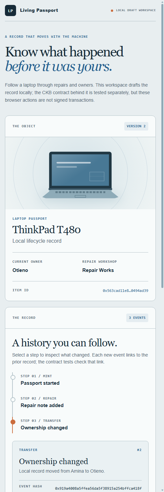

# Living Passport

An early CKB prototype for a laptop record that can survive a change of owner. Its first three transitions are **mint → repair attestation → transfer**. Each transition consumes one passport Cell and creates one successor. The Rust Type Script checks a unique starting OutPoint, stable item ID, sequence, hash-linked event history, unchanged capacity, the configured repair attester's participating Lock, and a changed owner Lock on transfer.

The browser workspace lets you create a laptop draft, add a repair note, transfer the draft record and export its JSON history. Run `npm run web` from this directory and open `http://127.0.0.1:4184`. It stores one in-memory draft while the local server runs; a restart clears it. The workshop and owner names in this view are labels, **not cryptographic identities**. The interface does not construct or sign the transactions exercised by the contract tests.




This is a **local contract experiment**, not a deployed product or proof that a physical repair happened. The test suite uses mock Cells and an `alwaysSuccess` Lock; that Lock must never hold real assets. A repair attestation means an input under the configured attester Lock participated in the transaction. It does not independently verify the workshop, device, or work performed. Event details are off-chain and represented by a hash in the Cell; preserving those details is an application responsibility.

## Verify

Run in WSL/Linux with Rust's `riscv64imac-unknown-none-elf` target and Node.js 22:

```bash
cd living-passport/rust-contract
cargo build --locked --offline --release
cd ..
npm ci
npm test
```

For the local draft rules alone, `node --test test/passport.test.js` also runs on Windows. The CKB-VM debugger in `ckb-testtool` was verified in WSL/Linux for this project.

The CKB-VM tests accept mint, repair and transfer, then reject a reused mint identity, redirected mint, repair without an attester, redirected repair, no-op transfer, skipped sequence, changed item ID, rewritten history, changed capacity and zero event hash.

## Contract boundary

Type Script args are 68 bytes: the 36-byte first funding OutPoint, followed by the 32-byte authorized repairer's Lock hash. One passport Cell exists per transaction group. Its 102-byte data holds a format version, action, sequence number, item ID, history root and latest event hash. The history root is `CKB_BLAKE2B(previous_root || event_hash)`; at mint, `item_id` substitutes for `previous_root`.

The initial version uses 300 CKB capacity for each passport Cell. That capacity remains with the Cell through repair and transfer; it is not a fee or a price. The current script has no close/reclaim transition. It does not bind a transfer's event hash to the new owner's Lock, nor an event's human-readable fields to an on-chain schema. It has not been run on public testnet. Those limits must be addressed before calling this a product for real items.
