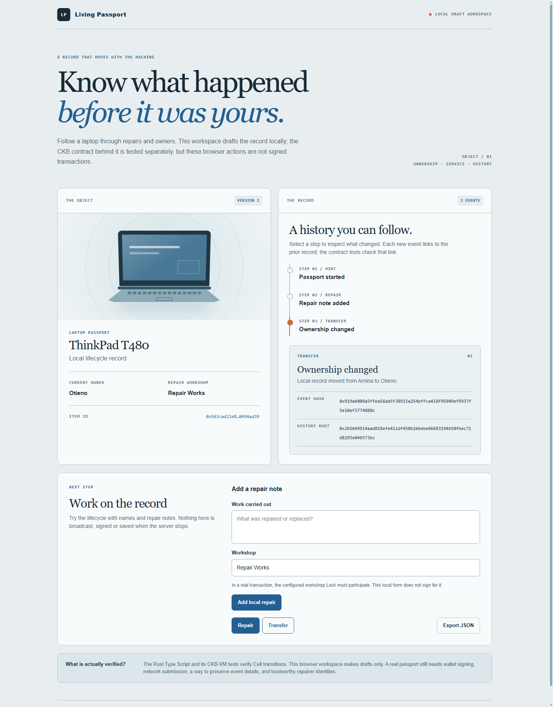

# CKB Builder Track - Week 8

Week Ending: 2026-10-11

## What I worked on

I started Living Passport as a record for second-hand equipment. A laptop is my first example, but the idea is not limited to laptops. I want the history to stay with an item as it is repaired and passed to another owner. The part I wanted to test this week was whether a CKB Cell could carry that history through real ownership changes, instead of keeping it in a normal app database.

The [Living Passport project](../../living-passport/) now has a Rust Type Script and a browser prototype. The script keeps the same item ID and history root as a passport Cell is replaced by its successor. It checks the readable event details, the actor and recipient Lock hashes, the sequence, and the Cell's capacity. The configured workshop Lock must participate in a repair transaction. Names are only labels; the Locks are what authorize a change.

## Signed local transactions

I deployed the script to an isolated OffCKB devnet and ran a five-step lifecycle: create, workshop repair, transfer, another repair with the new owner, and return transfer. I also connected the browser prototype to the local node so its create, repair, and transfer buttons submitted signed transactions. The browser service used disposable devnet keys on the local server. It was **not** signing with a user's wallet.

I restarted the service after three browser actions. It checked its saved latest Cell against a committed transaction, loaded the same three events, and let the new owner continue the record. The transaction hashes and what each test did are in [DEVNET.md](../../living-passport/DEVNET.md). These hashes are from the local chain, not public testnet.

## Moving towards a public app

The next problem was getting away from fixed devnet identities. I added a CCC wallet connector to a separate public-testnet preview, plus a reader that follows the passport's confirmed transactions and rebuilds its history. I also added create and transfer transaction builders that ask the connected wallet to approve the change. The new owner is a CKB testnet address, not just a typed name.

This is the local browser layout I used while working on the flow. The screenshot shows the interface, **not** proof of a public-chain transaction:

This preview builds, but I have **not** deployed this contract to public testnet or tested those wallet actions end to end there. The app says that plainly and keeps create and transfer disabled until a real deployment is configured. I have not enabled public workshop repair yet because it needs approval from both the owner and workshop wallets. The setup and limits are in [PUBLIC_TESTNET.md](../../living-passport/PUBLIC_TESTNET.md).

## Tests I ran

- CKB-VM accepted mint, workshop repair, and ownership transfer. It rejected forged event details, a wrong recipient, and other invalid changes.
- The local lifecycle submitted signed transactions and waited for each to commit before spending the successor Cell.
- The public history reader's tests reconstructed two ordered events from confirmed transaction fixtures and rejected a live Cell with the wrong owner.
- The full Living Passport test suite passed: **8 tests**. The public frontend production build also completed.

## What I learned

The Cell is not edited in place. Each action spends the old passport and creates the next one, so I had to check both the new record and the transaction that got it there. I also learned that a readable note is only useful as evidence if its exact bytes are bound to what the Type Script verifies. The chain can prove which Locks signed and how the record changed; it cannot prove that somebody really repaired a machine or that a typed owner name is accurate.

The laptop is a good test object because repairs and resale are easy to picture. If the same rules work, the passport could describe other second-hand equipment too. That wider use is still a product idea, not something I have tested with real equipment or users.
