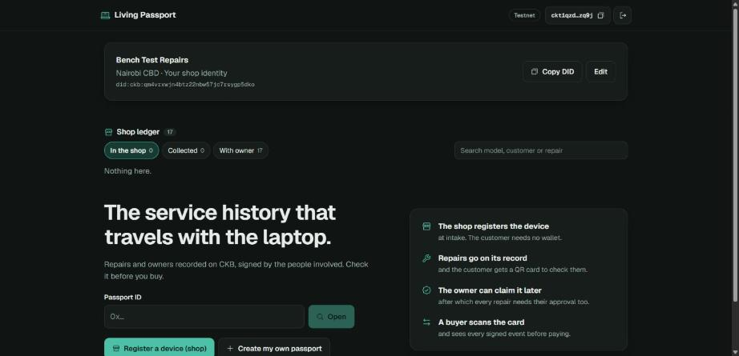
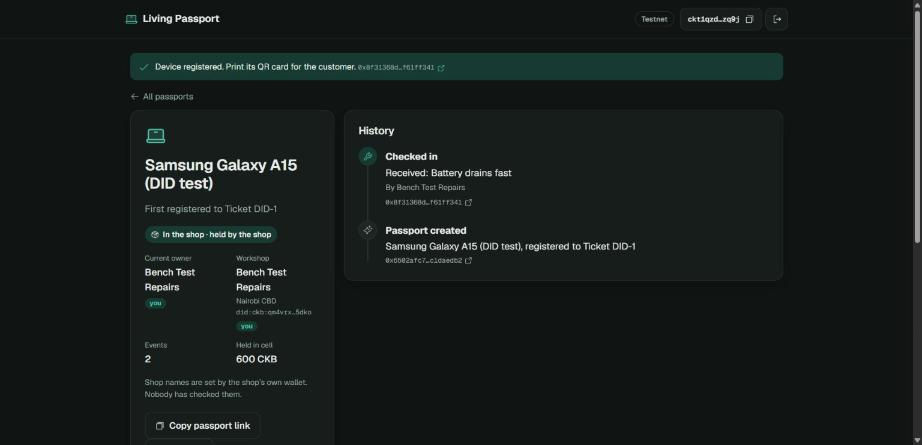
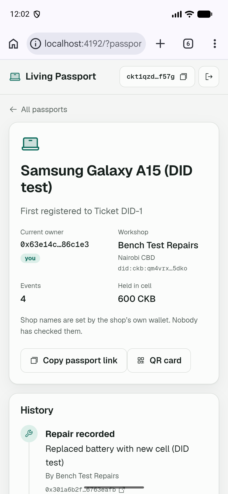
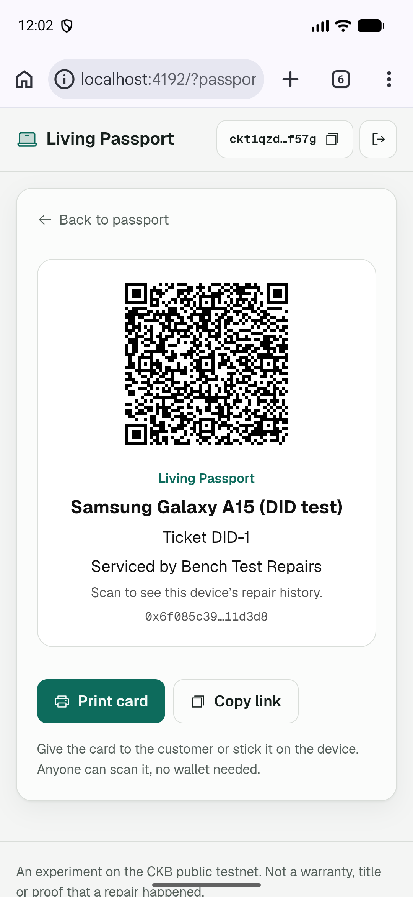
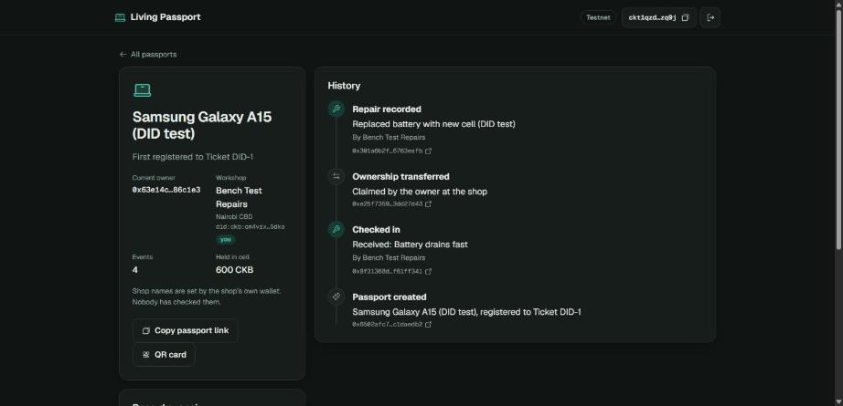

# CKB Builder Track - Week 11

Week Ending: 2026-11-06

## Work Completed

| Task | Status | Link |
| ---- | ------ | ---- |
| Shop-first mode | Done | `living-passport/public-web/` |
| JoyID co-signed repair on chain | Done | [tx](https://testnet.explorer.nervos.org/transaction/0x028227e78a423e5ef46ffafcb68b9aeb76d22719687a397a2c0f5d305298fe15) |
| Shop names with `did:ckb` | Done | `living-passport/src/public-did.js` |
| Test on a phone emulator and a laptop | Done | Local build, test wallets |
| Publish a shop name with JoyID | Not yet | |
| Visit a second repair shop | Not yet | |
| Read the groups and forum, look for what's next | Started | No decision yet |

Live app: [ckbuilders-two.vercel.app](https://ckbuilders-two.vercel.app)

### Shop-first mode: `living-passport/public-web/`

Last week Dflex said they don't want to rely on the customer, and asked what happens when a customer has no smartphone. So now the shop can register a device from its own wallet and hold the passport.

- The shop records repairs alone while it holds the passport. The customer needs no wallet
- Each device gets a printable QR card. Anyone can scan it, no wallet needed
- A customer with a wallet can request ownership. The shop hands the passport over in person, and after that every repair needs both signatures
- The home page has a shop ledger with In the shop, Collected and With owner filters, and search

What I learned:

- The contract didn't need to change. If the owner and the workshop are the same wallet, one signature already satisfies it
- I added two contract tests for this, including one that rejects a forged actor

### JoyID co-signed repair

Last week's report listed this as not done. I ran the whole shop-first flow with my JoyID wallet as the customer. The shop was a test key on an Android emulator. I approved the repair with JoyID.

Details:

- Device: Samsung Galaxy A14 / Ticket 0412
- Passport ID: `0x3d066fec30cf0270e64bec92a0a5b443d8e06bf14616a4b550a11db8198e489e00000000d80c812bfc5b23643dc8d46c47e553eec8b8d4bdff94eb309a26dde4ca11d3d8`
- Create tx: [`0x90e6a2bcea81bb1ab09d2307fea0571a4ce3f7f22a48ce9ffe7ea3ec8b07ada9`](https://testnet.explorer.nervos.org/transaction/0x90e6a2bcea81bb1ab09d2307fea0571a4ce3f7f22a48ce9ffe7ea3ec8b07ada9)
- Checked in tx: [`0xd30e64a5cf5e96cdacf3172dea258a5040460a6ff19db6b284cdc0bb7cfa28d0`](https://testnet.explorer.nervos.org/transaction/0xd30e64a5cf5e96cdacf3172dea258a5040460a6ff19db6b284cdc0bb7cfa28d0)
- Shop repair tx: [`0x28426e238f2132bba32b8a41094f1fa647f2aec62f80fa856fdab3ca6c0ca049`](https://testnet.explorer.nervos.org/transaction/0x28426e238f2132bba32b8a41094f1fa647f2aec62f80fa856fdab3ca6c0ca049)
- Handed to my JoyID wallet: [`0x90f45961d51a9c4bea6938b6e06d0b66a46b5816c8edf756c0694858b6131363`](https://testnet.explorer.nervos.org/transaction/0x90f45961d51a9c4bea6938b6e06d0b66a46b5816c8edf756c0694858b6131363)
- Co-signed repair: [`0x028227e78a423e5ef46ffafcb68b9aeb76d22719687a397a2c0f5d305298fe15`](https://testnet.explorer.nervos.org/transaction/0x028227e78a423e5ef46ffafcb68b9aeb76d22719687a397a2c0f5d305298fe15)

What I learned:

- The transaction hash stayed the same from the shop's draft to my approval, because the signatures aren't part of it
- The QR code decoded from an emulator screenshot opened the exact passport link

### Shop names with `did:ckb`: `living-passport/src/public-did.js`

A repair used to say it was signed by `0xd80c81…`, which means nothing to a customer or buyer. Now a shop can publish its name and location as a `did:ckb`, and the app shows the name instead.

- The name shows on the passport, on each repair ("By Bench Test Repairs"), on the QR card and on the owner's approval screen
- I used `@ckb-ccc/did-ckb` because `did:ckb` is already a known script in CCC. No new contract and no redeploy
- The name sits in the DID document under `services.living_passport`
- About 270 CKB stays in the cell. The shop gets it back when it removes the identity

What I learned:

- Anyone can create a DID cell under someone else's lock without their signature. If the app just looked up the DID on a wallet, a scammer could rename a shop
- So the app only accepts a name if that wallet also signed the transaction that wrote it. I tested this on testnet by creating a newer "Scam Shop" DID under the shop's lock from another wallet, and the app ignored it
- A DID only proves the same wallet published the name. Anyone can still publish "Dflex Technologies" from their own wallet, so the page says nobody has checked the names. Someone still has to vouch for a real shop

Details:

- Forged DID test: [`0x7aa3ab62a3c51f08ce81271ecbd9dc8da9578e4284be7eee94c87d69769e3aae`](https://testnet.explorer.nervos.org/transaction/0x7aa3ab62a3c51f08ce81271ecbd9dc8da9578e4284be7eee94c87d69769e3aae)
- Shop DID in the two-device test: `did:ckb:qm4vrxwjn4btz22nbw57jc7rsygp5dko`, created in [`0x6f085c392998cc56bbd0c40ebfba63980290fc9d05264af705a471b3a4c6ae08`](https://testnet.explorer.nervos.org/transaction/0x6f085c392998cc56bbd0c40ebfba63980290fc9d05264af705a471b3a4c6ae08). I removed it after the test

### Two-device test

The laptop browser was the shop and an Android emulator was the customer, both with test wallets on a local build.

| Step | Device | Result |
| ---- | ------ | ------ |
| Publish shop name | Laptop | Works |
| Register a device | Laptop | [tx](https://testnet.explorer.nervos.org/transaction/0x6502afc7c01e652b37cc194603baa936a5ca982c611ae1b7544738a9c1daedb2) |
| Open the same passport, request ownership | Phone | Name and DID show, read from chain by a different wallet |
| Hand over | Laptop | [tx](https://testnet.explorer.nervos.org/transaction/0xe25f7359543f51a6181af7288466e4b1c3ff13129020d0d3e885660a3dd27d43) |
| Draft a repair | Laptop | Goes to the inbox |
| Approve the repair | Phone | Screen says "Drafted by Bench Test Repairs". [tx](https://testnet.explorer.nervos.org/transaction/0x301a6b2f2223a0a8c4a76657deaa31bc042399039801f640f4da2a276763eafb) |
| See the repair | Laptop | Shows as event 4 |
| Close the passport and remove the name | Phone, laptop | CKB returned to both wallets |

Bugs I found:

- The shop card's content was off-centre and wrapped onto two lines. Fixed

The second emulator wouldn't start because my disk is almost full, which is why the second device was the laptop.

## Tests

- 21 local tests pass (contract tests in CKB-VM, the owner's review checks, and 6 new DID tests)
- Two-phone browser test passes on public testnet, now including the shop flow and shop names. Takes about 6.5 minutes
- Publishing a shop name has only been signed with test wallets so far, not JoyID

## Looking for what's next

I read the Telegram groups and the Nervos forum to see where the ecosystem is going.

- Most of the activity is around Fiber
- A lot of people are building dev tools, so that space is crowded
- Social login keeps coming up as a pain point
- Other things people are working on: iCKB relaunch on mainnet, CrowdCell, Vellum, Twine, Dular (M-Pesa on Fiber), Noir-CKB

Ideas I'm looking at:

- Chama contribution records: M-Pesa for the money, CKB for a record members can check
- Service history for vehicles like boda bodas
- A job-ticket app for repair shops that produces passports as a side effect

I haven't picked one. I want to talk to people first before building the next thing.

## Key Learnings

- The real shop's feedback changed the design more than any test did. Shop-first came straight from the Dflex visit
- The existing contract handled shop-first without a redeploy, because it only checks who signed
- On CKB anyone can put a cell under your lock, so a cell under a wallet doesn't mean that wallet agreed to it
- A DID gives a shop a name it controls, but it doesn't prove the shop is real
- Most people won't care about on-chain records for their own sake, so the record has to come from something they already do

## Next Steps

- Publish a shop name with JoyID on my phone
- Show shop-first to Dflex and visit a second shop
- Talk to chama treasurers and boda garages, then pick the next project
