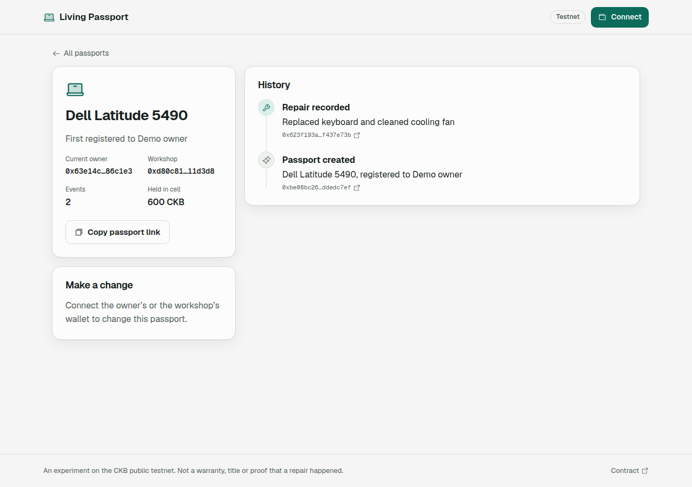
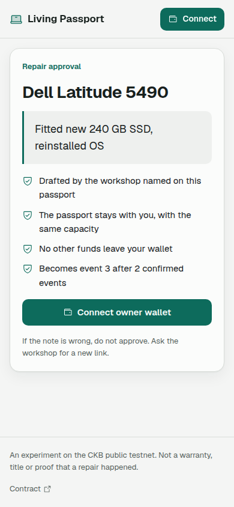
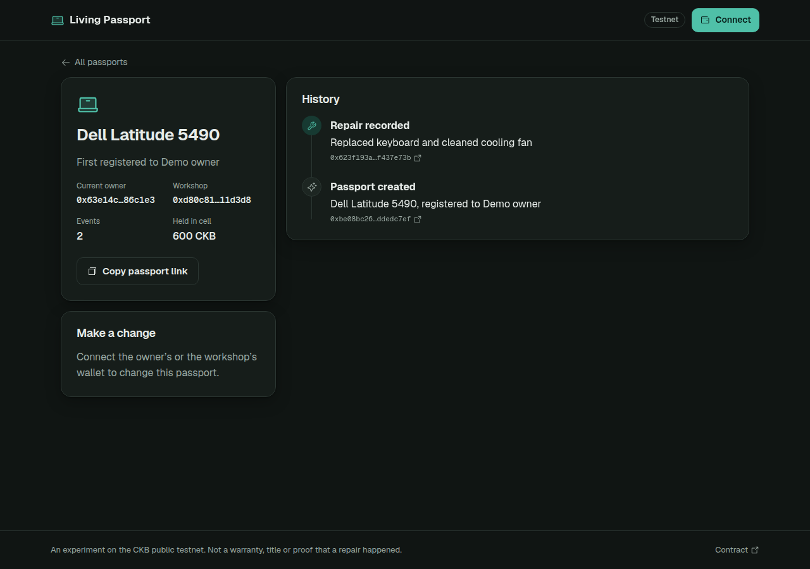

# CKB Builder Track - Week 9

Week Ending: 2026-10-20

## What I worked on

Last week Living Passport only worked on my local devnet, and the public preview had create and transfer switched off because the contract was never deployed. This week I wanted to get it onto public testnet properly, build the repair flow that needs two wallets, and get it to a point where I can show it to real repair shops. I also rebuilt the frontend because the old one was hard to use, especially on a phone.

The app is now live at [ckbuilders-two.vercel.app](https://ckbuilders-two.vercel.app/?passport=0xfd6f3361e145fb94d452080f25c86783db3a1e2c82a4e38a28306d7d01d21a3c00000000d80c812bfc5b23643dc8d46c47e553eec8b8d4bdff94eb309a26dde4ca11d3d8). That link opens a demo passport with one approved repair.

## Closing a passport

Before deploying I changed the contract. Every passport keeps 600 CKB inside its Cell, and the old contract had no way to get it back. That was fine on devnet but not for a pilot where I'll be creating passports for other people. The owner can now **close** a passport by spending it with no successor, and the capacity comes back to them. I did this first because changing the contract changes its code hash, so it had to happen before the testnet deployment and not after.

I added two CKB-VM tests: closing works, and closing two passports in the same transaction is rejected.

## Two-signer workshop repair

This was the main part of the week. The contract already required the workshop's Lock to be one of the inputs for a repair, but the passport itself is locked by the owner. So a repair needs **two signatures on one transaction**, from two different people, usually on two different phones.

How it works now:

1. The workshop opens the passport, types what they did and taps **Sign draft**. Their wallet adds one of its own Cells to pay the fee and signs only that input.
2. The signed draft gets compressed into a link. The workshop sends it to the owner on WhatsApp or SMS.
3. The owner opens the link and the app checks the draft before they sign: it spends exactly one passport, the passport is still live, nothing else leaves the owner's wallet, the workshop named on the passport is really signing, and the new record keeps the same owner and capacity with the next sequence number.
4. The owner signs their input and the app submits it.

The tricky part was that a signature covers the transaction hash, so nothing that changes the hash can happen after the first signature. JoyID's wallet adds its own CellDeps when it prepares a transaction, so I have to add the owner's Lock deps and witness space before the workshop signs. The owner's wallet is only allowed to fill in its own witness. If either wallet changes the hash while signing, the app refuses to submit.

The draft lives in the part of the URL after `#`, so it never gets sent to the server hosting the site.

## Deploying to public testnet

I wrote a [script](../../living-passport/scripts/testnet.mjs) that deploys the contract and then runs the whole lifecycle with throwaway testnet keys. It refuses to run unless the node says it is `ckb_testnet`. I got 100,000 testnet CKB from the faucet. The contract binary is 24 KB, so the code Cell alone holds about 24,000 CKB.

- Code hash: `0xb124f195e1d579f2d8d72325f9b7f232929cf9c7ee802effa071aaa589d1774e` (`data2`)
- Deploy tx: [`0x08007435…2401`](https://testnet.explorer.nervos.org/transaction/0x0800743595486b5cd4f21d2fac3f26cb59bd0bfdc1ab1310017302185e672401)

The first two runs failed, and both failures were real bugs:

- I was pushing plain objects into `tx.cellDeps` and CCC expects `CellDep` objects. It crashed with `e.eq is not a function`. This would have broken every action in the browser too, including in last week's preview.
- The owner's co-signature was rejected with **error -31** on the secp256k1 Lock. I had padded the owner's witness to 1,000 bytes so there was room for JoyID, but a secp256k1 signature is calculated over a 65-byte placeholder. The owner's wallet now prepares its own witness before signing. Witnesses are outside the hash, so the workshop's signature is still valid.

After fixing both, the full run passed on public testnet:

| Step | Result |
| --- | --- |
| Create | [`0x55a81a4b…f549c`](https://testnet.explorer.nervos.org/transaction/0x55a81a4beef9603923397744a705811e6b4dc1a9065d6abd6c6501ee23cf549c) |
| Repair with only the workshop's signature | rejected by the node (`TransactionFailedToVerify`) |
| Repair co-signed by the owner | [`0x79653f17…991f`](https://testnet.explorer.nervos.org/transaction/0x79653f179d3fa8dc5dc9068aab2fd845bdc6ae6edffab5d11e733ae0ddfe991f) |
| Transfer to a buyer | [`0xc1192572…3ac1`](https://testnet.explorer.nervos.org/transaction/0xc11925724897b0318d26266d639aea55f7537612d07b5e63db586bf6f8383ac1) |
| Buyer closes it | [`0x25c16e30…a110`](https://testnet.explorer.nervos.org/transaction/0x25c16e30efbdd6f98538d81ff0e239c20210a0ad99d86298ef1046e84d7fa110) |

The buyer's balance went from 100 CKB to 699.99986976 CKB after closing, so the 600 CKB really came back, minus the fee.

## New frontend

I rebuilt the public app from scratch. It is mobile first, because shop staff and customers will mostly use phones, and it follows the system light or dark setting. It shows different actions depending on which wallet is connected: the workshop sees the repair form, the owner sees hand over and close, and anyone else just sees the history. Every signed action goes through a confirm screen that says what will happen and what is public.

## Tests I ran

- **13 local tests pass**: the CKB-VM contract tests (now including close), the history reader, and new tests for the owner's review. Those check that it rejects a draft that redirects the passport, changes the capacity, claims a different workshop, skips a sequence number, spends extra owner funds, has no workshop input, or uses a passport that already moved. Plus the share link round trip.
- The full testnet lifecycle above, including the expected rejection.
- The live Vercel site loads the demo passport from testnet with no errors, on desktop and phone sizes.

## What is not done yet

- **JoyID has not been tested end to end.** The testnet run used private-key signers, so it proves the contract and the transaction logic, but not JoyID's signing popups. Owners who use a JoyID sub-key (a second device on their account) are not supported for co-signing yet.
- **No real shop has used it yet.** I wrote a [pilot guide](../../living-passport/PILOT.md) for visiting two repair shops this week, with the steps, privacy rules, the questions I'll ask, and a table for the results.

## What I learned

Getting two people to sign one CKB transaction is mostly about order. Everything that changes the hash (inputs, outputs, CellDeps, fees) has to be settled before anyone signs, and after that each person can only touch their own witness. I also learned not to trust local tests alone. Both bugs this week passed my mock tests and only showed up against a real node.

Honestly I'm not fully sure Living Passport is the right product. The plan is to run the pilot with two shops, write down what they actually say, and then decide whether to stop or keep going.
