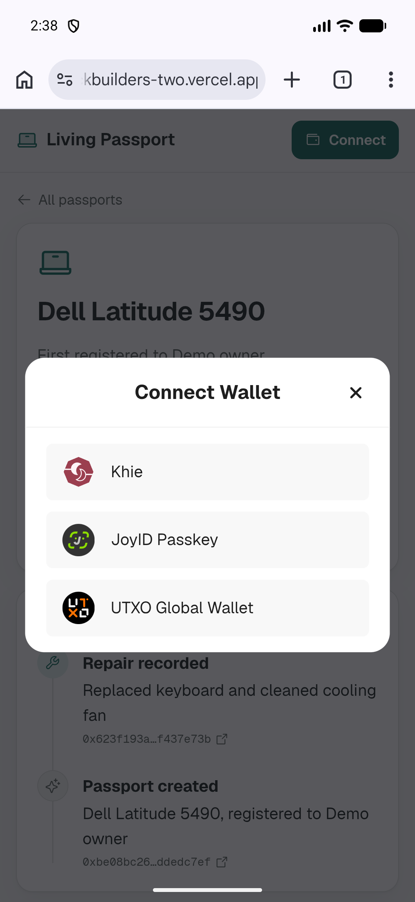
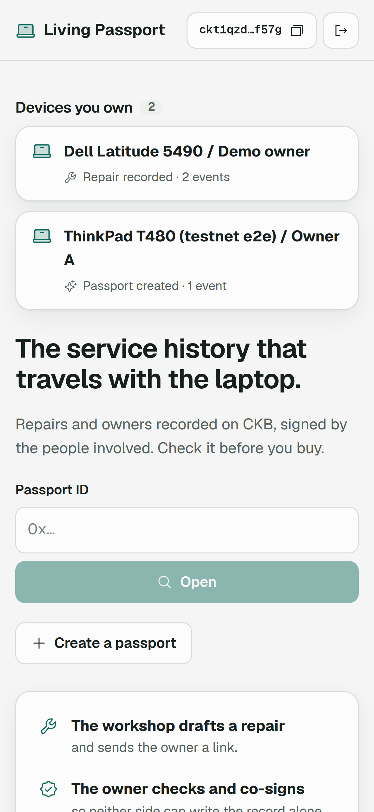
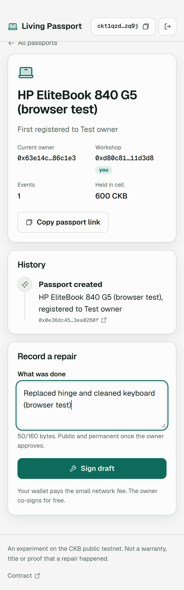
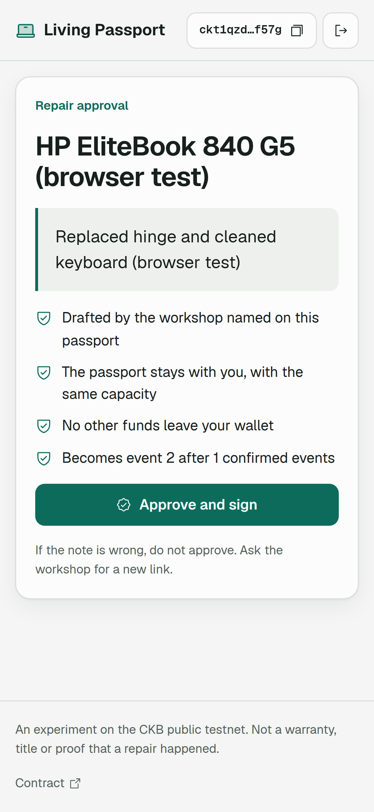
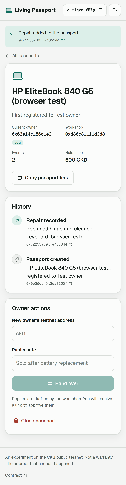
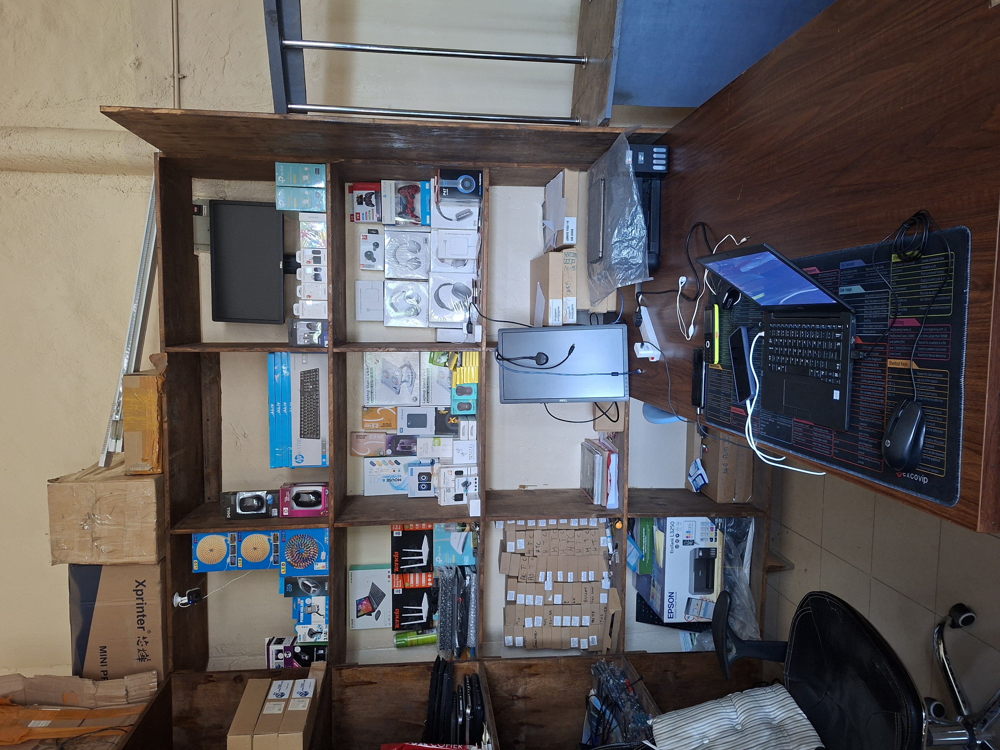
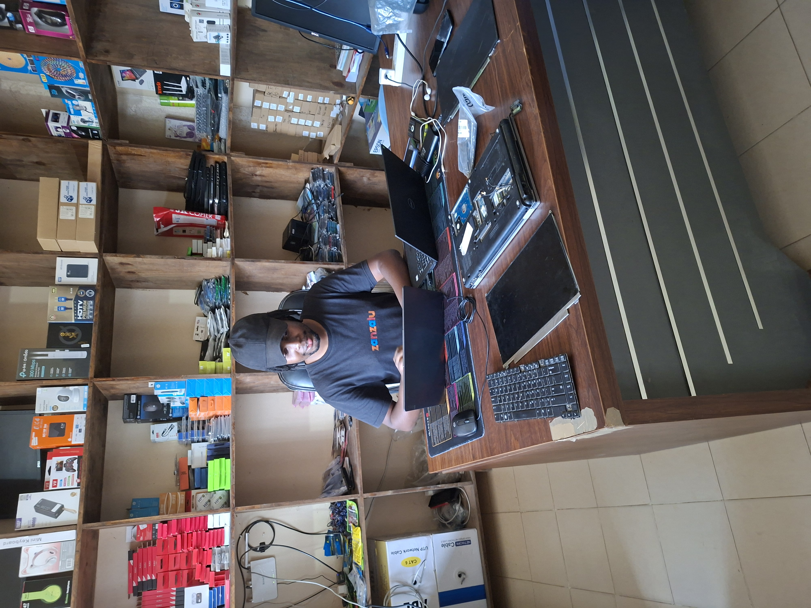
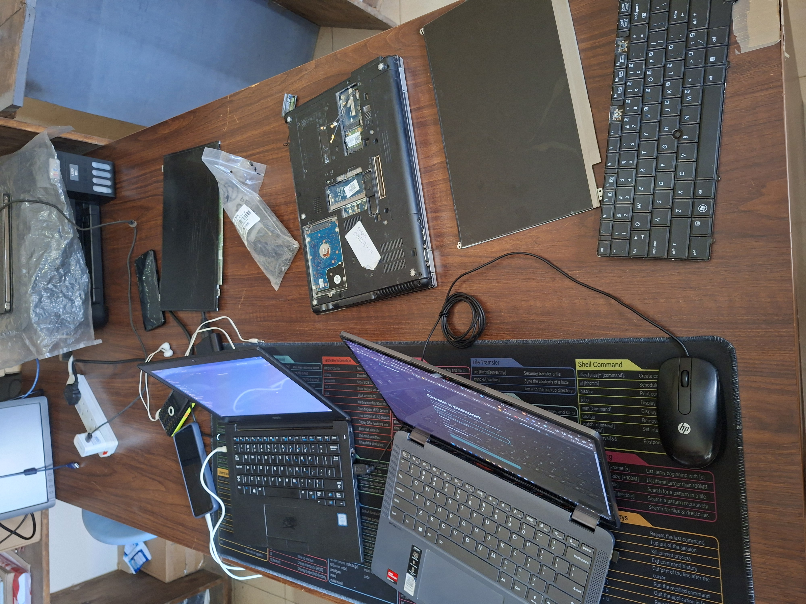

# CKB Builder Track - Week 10

Week Ending: 2026-10-30

## Work Completed

| Task | Status | Link |
| ---- | ------ | ---- |
| Create a passport with JoyID on my phone | Done | [passport](https://ckbuilders-two.vercel.app/?passport=0x91187a373b4c3ce7e22b3257a5b5a7f99d7df14f6c90e50c8c19013430a3fba30000000066927c92953662bfdd926f6b35ebdc6e94db7dc57904f07374b1de126b81fe6f) |
| Fix bugs found on real phones | Done | `living-passport/` |
| My devices page | Done | `living-passport/public-web/` |
| Repair inbox on my Contabo server | Done | `living-passport/inbox/` |
| Demo data on testnet | Done | `living-passport/scripts/testnet.mjs` |
| Repair shop visit | 1 of 2 done | Dflex Technologies |
| JoyID co-signed repair on chain | Not yet | |

Live app: [ckbuilders-two.vercel.app](https://ckbuilders-two.vercel.app)

### Testing on real phones

Last week everything was tested with private keys in a script. This week I used the app with JoyID, first on an Android emulator and then on my phone.

I created a passport for my Samsung A56 from my phone with JoyID. It is the first passport signed by a real wallet instead of a test key.

Details:

- Passport ID: `0x91187a373b4c3ce7e22b3257a5b5a7f99d7df14f6c90e50c8c19013430a3fba30000000066927c92953662bfdd926f6b35ebdc6e94db7dc57904f07374b1de126b81fe6f`
- Create tx: [`0xf7c4f799de2b1d6c10deec17ddc645fc1bea4dfcd0b98c78caa5fdcf9ed13aef`](https://testnet.explorer.nervos.org/transaction/0xf7c4f799de2b1d6c10deec17ddc645fc1bea4dfcd0b98c78caa5fdcf9ed13aef)
- Owner wallet: JoyID, workshop: a second wallet

Bugs I found and fixed:

- Creating a passport failed if the wallet's CKB was split across more than one cell, which happens after claiming from the faucet twice. It now collects from several cells
- Errors showed at the top of the page while I was scrolled down at the button, so on a phone it looked like nothing happened. The page now scrolls up to the message
- I pasted a passport ID into the workshop address field and got `Unknown address format`. The error now says the field needs a `ckt1…` address
- Tapping the wallet button disconnected the wallet. Now it copies the address and disconnect is a separate button

### My devices: `living-passport/public-web/`

Moving the passport ID, workshop address and repair link between two phones meant a lot of copying. A shop with many phones wouldn't do that.

When you connect a wallet, the home page now lists every passport you own and every passport where you are the workshop. Tap one to see its history.

### Repair inbox: `living-passport/inbox/`

A repair needs the workshop and the owner to both sign. Before this, the workshop had to send the owner a link. Now the signed draft also goes to a small inbox server, and the owner sees "Repair waiting for your approval" on their devices page.

What I learned:

- The draft only has the workshop's signature, so the inbox doesn't hold anything secret
- The inbox runs the same checks as the owner's app before saving a draft, and deletes drafts once the passport has moved on
- The owner's app checks the draft again before signing, so the inbox can't get anyone to approve a bad repair. If the inbox goes down, the link still works
- Hosting: Node + pm2 behind nginx with a Let's Encrypt certificate, at `passport-api.mandaristudios.com`

### Demo data: `living-passport/scripts/testnet.mjs`

I added a `seed` command that registers devices with repair histories. I used it to create 12 phones and laptops with 25 repairs so the app has something to show.

- These are made-up demo devices and owners, not shop records
- All repairs are signed by my own test workshop wallet

## Tests

- 13 local tests pass (contract tests in CKB-VM and the owner's review checks)
- Two-phone browser test passes on public testnet: owner creates, workshop drafts a repair, owner finds it in the inbox and approves, then closes the passport. Takes about 2 minutes
- Live site checked in Android Chrome on the emulator

## Repair Shop Visit: Dflex Technologies

I visited Dflex Technologies and talked to the owner and the technician. We did a demo in the app and went through both the owner and workshop flows.

Their reaction: interested.

Questions they asked:

- How does it work?
- Does it need internet?
- Can he do it on his own smartphone?
- What happens when a customer doesn't have a smartphone?

What they liked:

- JoyID. Creating a wallet with a passkey is easier than managing seed phrases and passwords

Concerns:

- Someone faking records
- They don't keep repair records right now. They rely on what the owner tells them about the device
- He asked how it could work without relying on the customer side. He thinks it should mainly be used within the repair network

Other uses he suggested:

- Helping with theft, by identifying stolen phones and parts

Would he use it:

- Yes, as in-house documentation and an inventory ledger for the shop

He also said they do a lot of repairs, and many clients don't understand phone repairs or what happens to their phones.

## Key Learnings

- Testing with scripts proved the transactions work, but every real bug this week came from using it on a phone
- JoyID passkeys make wallets easy enough for a shop owner to use
- I built Living Passport around the owner. The shop sees itself as the one who should keep the records, and is more interested in its own records, inventory and stolen devices
- If records are mainly kept between shops, the question is which shops can be trusted, not which owners

## Next Steps

- Approve a repair with JoyID on my phone so the full two-signer flow is done with real wallets
- Visit a second shop and ask about the shop-first idea
- Decide whether to turn this into a shop tool or close Living Passport
