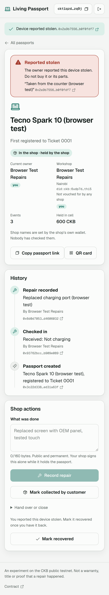
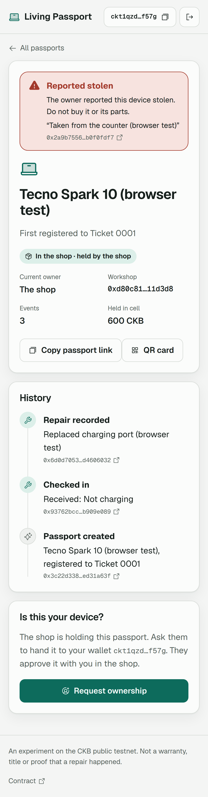
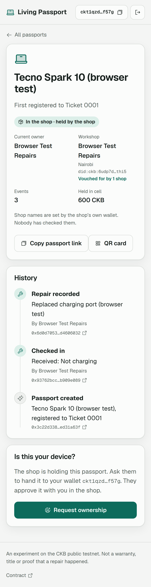

# CKB Builder Track - Week 12

Week Ending: 2026-11-13

## Work Completed

| Task | Status | Link |
| ---- | ------ | ---- |
| Stolen device flag | Done | `living-passport/src/public-stolen.js` |
| Shops vouching for each other | Done | `living-passport/src/public-did.js` |
| Two-phone browser test with both | Done | `living-passport/scripts/browser-e2e.mjs` |
| Publish a shop name with JoyID | Not yet | |
| Show shop-first to Dflex | Not yet | |
| Visit a second repair shop | Not yet | |

Live app: [ckbuilders-two.vercel.app](https://ckbuilders-two.vercel.app)

### Stolen device flag: `living-passport/src/public-stolen.js`

The owner, or the shop while it holds the device, can report a passport stolen. Anyone who opens it or scans the QR card sees a warning not to buy the device or its parts. This came from Dflex, who raised theft and stolen parts.

What I learned:

- I wanted this as a new event in the contract, but the owner can't add an event alone. Transfer needs a different lock and a repair needs the workshop
- A redeploy would also leave every existing passport behind, so I didn't change the contract
- Instead a report is a small cell under the owner's lock. Its data is `LPSTOLEN`, the passport ID and a short note
- The app finds it with an indexer search on the owner's lock and a prefix filter on the cell data
- Anyone can put a cell under someone else's lock, so a report only counts if the owner's lock also signed it. Same rule as the DIDs last week
- A report only counts while that wallet still owns the passport, so a hand-over clears it
- The report holds about 166 CKB. "Mark recovered" spends it and you get it back
- While a device is reported stolen, nobody can request ownership of it from the shop
- Verified it on testnet: wrote a fake "stolen" report into the owner's wallet from another wallet, and the app ignored it

Details:

- Device: Dell Latitude 5490 / Demo owner
- Forged report tx: `0xed7e4d837b4190feaf7f1bfb2a15ee8515a3f3d60f87bfb96cbe483dcfd2afcb`
- Report tx: `0x259e841ecde15cc0a17c197933ed5b1646e6bccb9b55d845d254074846dbb24a`
- Recovered tx: `0xb61699a89cecb6afdecba8f5dfb2118468dce525f9544e80d079498d5b572f99`
- A report is the owner's claim. Nobody checks it

### Shops vouching for each other: `living-passport/src/public-did.js`

Last week anyone could publish a shop called "Dflex Technologies". Now a shop can vouch for another shop's `did:ckb`, and passports show "Vouched for by 1 shop" under the workshop.

What I learned:

- No new cell type. The vouches go in the shop's own DID document under `services.living_passport.vouches`, as a list of `did:ckb` strings
- The app reads every signed shop document, keeps the newest one per wallet, then counts who vouches for whom
- A shop can't vouch for itself, and vouches from a document another wallet forged don't count
- Editing a shop's name kept dropping its vouches at first. Fixed, and added a test for it
- Each vouch makes the DID document bigger, so the shop locks about 45 more CKB
- A shop can vouch by pasting a DID, or with a "Vouch for [shop]" button on any passport that shop worked on
- A vouch is only as good as the shop giving it. Someone could make a few fake shops that vouch for each other, so the page shows the names, not just a number
- Verified it on testnet: shop A vouched for shop B, a self-vouch was dropped, renaming kept the vouch, and removing the identity cleared it

## Tests

- 28 local tests pass, 7 of them new for stolen reports and vouches
- Two-phone browser test passes on public testnet, now with report stolen, the customer seeing the warning, mark recovered, and a second shop vouching. Takes about 10 minutes
- Bug found: the customer could still request ownership of a device reported stolen. Fixed after the browser run, so it's only checked by the tests and the build
- Didn't test on the emulator this week

## Key Learnings

- What the contract allows decides what can be on-chain history. Not everything needs to be in the contract
- A plain cell with a known prefix in its data is enough for a simple record, and the indexer can search for it
- The signed-by-the-holder check from last week works for any cell, not just DIDs
- Changing a deployed contract has a cost: every existing cell stays on the old one
- Vouching only means something once a second real shop is involved

## Next Steps

- Show the stolen flag and vouching to Dflex
- Visit a second repair shop so there's someone real to vouch
- Publish a shop name with JoyID on my phone
